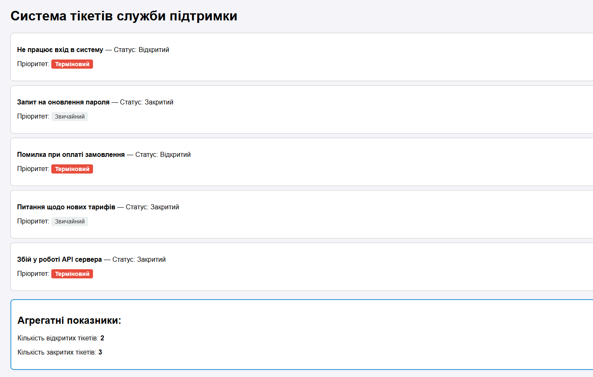

# Практична робота №1: Розробка PHP-структур та вивід результатів

**Дисципліна:** Сучасні технології розробки WEB-застосувань мовою програмування PHP
**Студент:** Сизоннко Артем Олександрович,
**Група:** ІО-45
**Варіант:** 19 (Система тікетів служби підтримки)

## Мета роботи
Ознайомитися з базовим синтаксисом мови програмування PHP (змінні, масиви, умовні конструкції, цикли, функції) та навчитися інтегрувати PHP-код у HTML-розмітку для динамічного виведення даних.

## Опис предметної області (Варіант 19)
Реалізовано симуляцію простої системи тікетів служби підтримки (Helpdesk). 
Кожен тікет містить наступні поля:
- `subject` (тема звернення)
- `priority` (пріоритет: urgent, normal, low)
- `status` (статус: open, closed)

## Реалізований функціонал
1. **Масив даних:** Створено асоціативний масив із 5 тікетів.
2. **Типізована функція:** Написано функцію `formatTicket(array $ticket): string` для форматованого виведення теми та статусу.
3. **Умовна логіка:** Додано перевірку: якщо пріоритет `urgent`, тікет отримує спеціальну мітку «Терміновий» і виділяється червоним кольором.
4. **Вивід на сторінку:** За допомогою циклу `foreach` дані динамічно виводяться у вигляді HTML-карток.
5. **Агрегатні показники:** Реалізовано підрахунок та виведення загальної кількості відкритих та закритих тікетів.

## Скріншот результату:
